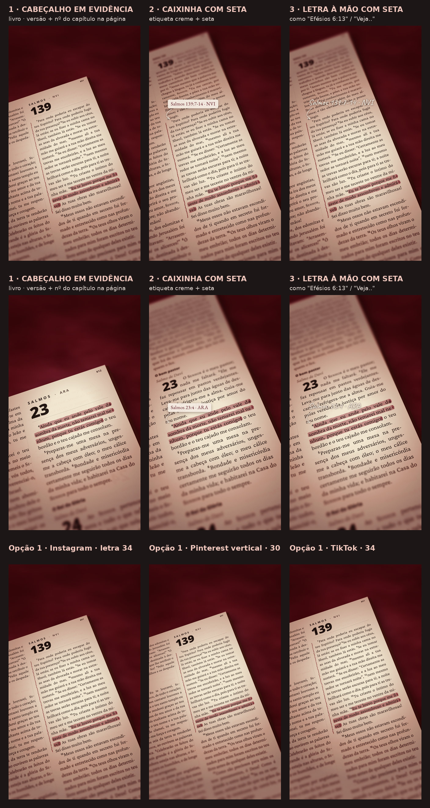
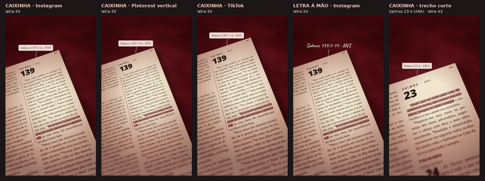

# Guia do modelo: trechos da Bíblia para o Stories

**As 3 redes lado a lado:** [referencia/mapas-3-redes.png](referencia/mapas-3-redes.png)

## A arte

Uma foto "espontânea" de uma Bíblia aberta: a página em close e na diagonal, com o trecho grifado e nítido. O resto da página vai desfocando aos poucos, e a luz é baixa, com as bordas caindo para vinho escuro.

| Elemento | Como é |
|---|---|
| Página | Papel bíblia creme, duas colunas, cabeçalho ("SALMOS 22, 23") e número da página, números dos versículos, títulos de seção, número grande do capítulo, "Senhor" em versalete e o verso da folha aparecendo de leve por transparência |
| Trecho | Na coluna da direita, todo nítido, com grifo de marca-texto onde você pedir (borda irregular, levemente torto, mais forte no fim do traço) |
| Traço na margem | Em trecho longo: risco de caneta vinho na margem, do começo ao fim do trecho |
| Foco | Faixa nítida em volta do trecho; o desfoque aumenta aos poucos, em 9 níveis, para cima e para baixo |
| Luz e cor | Luz baixa e quente no trecho; bordas em vinho escuro; granulado de filme |
| Em volta | Veludo vinho, capa de couro e corte das folhas avermelhado (aparecem no canto da imagem) |
| Textos por cima | **Nenhum.** Sem seta, legenda, referência ou assinatura, para parecer uma foto espontânea |

## Padrão (quando você não diz nada)

| Item | Padrão |
|---|---|
| Formato | PNG 1080 × 1920 |
| Versão | **NVI**, sempre (inclusive os versículos vizinhos que completam a página) |
| Grifo | Vinho, na frase que você pedir (sem frase = trecho curto todo grifado) |
| Trecho curto (até 3 versículos e até 300 letras) | Trecho nítido + grifo |
| Trecho longo (4 versículos ou mais, ou mais de 300 letras) | **Jeito B:** trecho nítido + traço na margem + grifo na frase-chave |
| Tom | Vinho (luz baixa, bordas escuras) |
| Superfície | Veludo vinho |
| Tamanho da letra | Automático: começa em 50 px e diminui até o trecho grifado caber na área livre (mínimo por rede: veja abaixo) |
| Texto | Transcrito fielmente, sem mudar as palavras |
| Contexto da página | Eu completo com os versículos vizinhos (antes, depois e a coluna ao lado), que ficam desfocados |
| Divisão | Só no Instagram: vira 2 stories **automaticamente** se a letra precisar ficar menor que 24 px, cortando no fim de um versículo perto da metade. TikTok e Pinterest: sempre 1 imagem |

## Letra mínima e divisão por rede

| Rede | Letra mínima | Se o trecho não couber |
|---|---|---|
| **Instagram** | 24 px | Divido em **2 stories**, cortando no fim de um versículo |
| **TikTok** | 20 px | Sempre **1 imagem** |
| **Pinterest vertical** | 20 px | Sempre **1 pin** |

No TikTok e no Pinterest, se o trecho não couber nem com letra 20, a letra continua diminuindo até 16 e eu aviso. Nesse caso, o ideal é encurtar o trecho.

Nos exemplos, Salmos 23:4 coube com letra 48 (Instagram e TikTok) e 42 (Pinterest vertical). 1 Coríntios 13:4-7, com dois grifos, coube com 44 e 39. Salmos 139:7-14 (8 versículos) coube com 37 e 33. Num teste com 18 versículos, o Instagram dividiu sozinho em 2 stories (letra 35 e 34).

## Trechos longos: o padrão e as cartas na manga

| | Jeito | Como fica | Como pedir |
|---|---|---|---|
| **Padrão** | **B · Traço na margem + grifo na frase-chave** | Trecho todo nítido, traço de caneta vinho na margem do começo ao fim, marca-texto só na frase-chave | É o padrão em trecho longo: basta mandar o trecho e dizer a frase. Se você não disser, eu escolho a frase mais marcante e te aviso qual foi |
| Carta na manga | **A · Tudo grifado** | Marca-texto em todas as linhas do trecho | "tudo grifado" |
| Carta na manga | **C · Em 2 stories** | Instagram em 2 stories, cada um com metade do trecho todo grifado, letra maior. TikTok e Pinterest continuam em 1 imagem | "em 2 stories" (ou "divide em 2") |

As cartas na manga combinam: "em 2 stories com traço" faz cada story no jeito B.

Exemplo do padrão nas 3 redes: [referencia/exemplo-salmos-139-7-14.png](referencia/exemplo-salmos-139-7-14.png)

## Citação: de onde vem o versículo (em teste)

| Jeito | Como fica | Mostra |
|---|---|---|
| **1 · Cabeçalho em evidência** (`"citacao": "cabecalho"`) | No alto da página: "SALMOS · NVI" e o número do capítulo grande; o trecho começa logo abaixo, como uma página que começa ali | Livro, capítulo, versão; os versículos aparecem nos números do próprio texto. Nenhum texto por cima da foto |
| **2 · Caixinha com seta** (`"citacao": "caixinha"`) | Etiqueta creme "Salmos 139:7-14 · NVI" logo acima do trecho, com seta curta até o começo | Tudo, por extenso |
| **3 · Letra à mão com seta** (`"citacao": "mao"`) | Igual à 2, em letra à mão creme, sem caixa | Tudo, mas fica pouco legível sobre o papel claro |

### Cabeçalho + caixinha no veludo (em teste)

O cabeçalho do capítulo na página e, **ao lado da Bíblia, sobre o veludo**, a etiqueta com a referência por extenso e uma seta curta até o cabeçalho (`"citacao": "cabecalho", "etiqueta": "caixinha"`). A etiqueta procura sozinha o lugar livre de veludo mais perto do cabeçalho; pode avançar pelas laterais (no TikTok pode ficar sob os botões), mas nunca pelo topo nem pela base reservados. Em letra à mão (`"etiqueta": "mao"`) ela fica legível, porque o veludo é escuro.

### Só a caixinha no veludo, sem cabeçalho em destaque (em teste, Instagram)

A página fica como no padrão (a abertura do capítulo desfocada com o resto) e a caixinha vai ao lado, sobre o veludo, com a seta encostando no fim da primeira linha do trecho (`"etiqueta": "caixinha"`, sem `citacao`). A referência fica sempre em **uma linha** ("Salmos 139:7-14 · NVI"), numa caixinha comprida e fina; se o veludo não tiver espaço, a letra diminui de 40 até 28.

A seta é **fluida**, como feita com o dedo nas referências "Veja..": sai do centro da caixinha, abre num arco suave pelo veludo e chega **apontando para o trecho como um todo** (na direção do centro do trecho). A ponta fica no veludo, ao lado do trecho (um pouco acima do meio), com folga da borda da Bíblia. Traço de caneta afinando nas pontas e ponta aberta. Para a seta ter espaço, a caixinha fica uns 330 px acima do começo do trecho.

Exemplo: `saida/citacao/salmos-139-7-14-caixinha-seta-fluida-1-instagram.png`

Exemplo: [saida/citacao/salmos-139-7-14-caixinha-veludo-sem-cabecalho-1-instagram.png](saida/citacao/salmos-139-7-14-caixinha-veludo-sem-cabecalho-1-instagram.png) (gerado por `pedidos/citacao/salmos-139-7-14-caixinha-veludo-sem-cabecalho-1-instagram.json`)

## Áreas livres (iguais ao modelo de livros)

| Área | Instagram | TikTok | Pinterest vertical |
|---|---|---|---|
| Tamanho | 1080 × 1920 | 1080 × 1920 | 1080 × 1920 |
| Topo livre | 250 px | 150 px | 270 px |
| Base livre | 250 px | 450 px | 440 px |
| Laterais livres | 150 px | 150 px | 195 px |

O trecho grifado fica sempre **inteiro dentro da área livre**. A página da Bíblia pode passar por baixo das áreas reservadas, porque ali ela já está desfocada.

## Opções (é só pedir)

| Você diz | Resultado |
|---|---|
| "[referência], grifa [frase]" | Grifo vinho só na frase pedida |
| "grifa [frase 1] e [frase 2]" | Dois (ou mais) grifos separados no mesmo trecho |
| "tudo grifado" | Carta na manga A: marca-texto em todas as linhas |
| "em 2 stories" / "divide em 2" | Carta na manga C: 2 stories no Instagram |
| "sem traço" / "com traço" | Tira ou põe o traço na margem |
| "grifo cereja / castanho / vermelho" | Grifo nessa cor |
| "em couro" / "em madeira" | Troca o veludo pela superfície pedida |
| "só até [palavra]" / "começa em [palavra]" | Corto o trecho onde você indicar |

**Exemplo de pedido:**

> [print] Salmos 139:7-14, grifa "Eu te louvo porque me fizeste de modo assombroso e admirável"

Resultado: [referencia/exemplo-salmos-139-7-14.png](referencia/exemplo-salmos-139-7-14.png)

## Paleta

| Cor | Grifo (sobre o papel, em multiplicação) |
|---|---|
| Vinho (padrão) | `rgba(140,20,45,.44)` |
| Cereja | `rgba(210,36,70,.40)` |
| Castanho avermelhado | `rgba(168,70,40,.42)` |
| Vermelho | `rgba(225,45,45,.38)` |

| Elemento | Cor |
|---|---|
| Papel | `#F2EADC` |
| Tinta | `#251D19` |
| Veludo | `#4E0E18` |
| Capa de couro | `#4A1A16` |
| Corte das folhas | `#8E2A26` |

## Histórico da criação

- [rascunhos-v1.png](referencia/rascunhos-v1.png): primeiros caminhos (página grifada × frase sobre a Bíblia).
- [rascunhos-v2-grifado.png](referencia/rascunhos-v2-grifado.png): cores da marca. Escolhido o **vinho**, sem fita marcadora e sem assinatura.
- [jeitos-trecho-longo.png](referencia/jeitos-trecho-longo.png): trecho longo. Escolhido o **B** como padrão; A e C ficam como cartas na manga.
