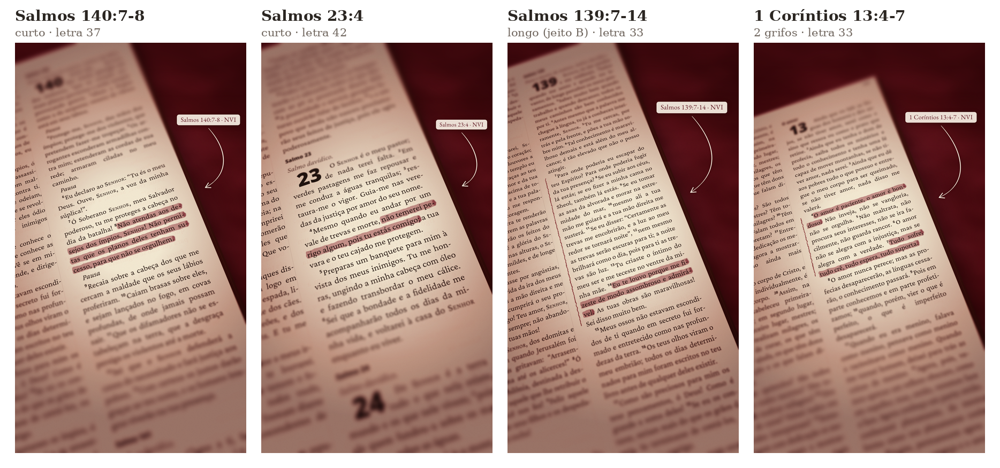
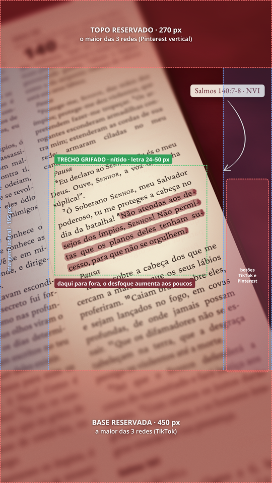

# Guia do modelo: trechos da Bíblia para o Stories (versão oficial)

**Uma imagem só serve para as 3 redes:** o mesmo arquivo 1080 × 1920 vai para o Instagram (story), o TikTok e o Pinterest (pin vertical).

## A arte

Uma foto "espontânea" de uma Bíblia aberta: a página em close e na diagonal, com o trecho nítido e grifado, o resto da página desfocando aos poucos, luz baixa com as bordas caindo para vinho escuro e, ao lado da Bíblia, sobre o veludo, uma caixinha com a referência e uma seta feita à mão apontando para o trecho.

| Elemento | Como é |
|---|---|
| Página | Papel bíblia creme, duas colunas, cabeçalho e número da página, números dos versículos, títulos de seção, número grande do capítulo, "Senhor" em versalete e o verso da folha aparecendo de leve. A abertura do capítulo fica **desfocada** junto com o resto da página, sem destaque |
| Trecho | Na coluna da direita, todo nítido |
| Grifo | Marca-texto **vinho** na frase pedida (borda irregular, levemente torto) |
| Traço na margem | Em trecho longo: risco de caneta vinho na margem, do começo ao fim do trecho |
| Desfoque | Faixa nítida em volta do trecho; o desfoque aumenta **aos poucos, em 9 níveis**, para cima e para baixo (degradê suave, sem "faixas") |
| Luz e cor | Luz baixa e quente no trecho, bordas em vinho escuro, granulado de filme |
| Em volta | Veludo vinho, capa de couro e corte das folhas avermelhado |
| **Caixinha** | Creme, comprida e fina, **uma linha só**: "Salmos 140:7-8 · NVI". Fica **sobre o veludo, ao lado da Bíblia**, nunca em cima da página nem do trecho. Letra 32 (diminui até 28 se o veludo for estreito) |
| **Seta** | Traço fino como feito com o dedo (afina nas pontas), ponta aberta. Sai do **centro** da caixinha, faz um arco suave pelo veludo e chega **apontando para o trecho como um todo**; a ponta para no veludo, com folga da borda da Bíblia |

## Padrão (quando você não diz nada)

| Item | Padrão |
|---|---|
| Formato | **1 imagem** PNG 1080 × 1920 para as 3 redes |
| Versão | **NVI**, sempre (inclusive os versículos vizinhos que completam a página) |
| Trecho curto (até 3 versículos e até 300 letras) | Trecho nítido + grifo na frase pedida (sem frase = trecho todo grifado) |
| Trecho longo (4 versículos ou mais, ou mais de 300 letras) | **Jeito B:** trecho nítido + traço na margem + grifo na frase-chave |
| Citação | Caixinha no veludo + seta fluida |
| Tamanho da letra | Automático: começa em 50 px e diminui até o trecho caber na área livre comum **e** a caixinha caber no veludo. Mínimo 24 px |
| Se não couber com letra 24 | Gero **as 3 versões por rede** automaticamente: Instagram em 2 stories, TikTok e Pinterest em 1 imagem cada (letra mínima 20) |
| Texto | Transcrito fielmente, sem mudar as palavras |
| Contexto da página | Eu completo com os versículos vizinhos (antes, depois e a coluna ao lado), que ficam desfocados |
| Textos por cima da foto | Só a caixinha e a seta. Nada de legenda, assinatura ou @ |

| Trecho | Letra na imagem única |
|---|---|
| Salmos 140:7-8 | 37 |
| Salmos 23:4 | 42 |
| Salmos 139:7-14 (8 versículos) | 33 |
| 1 Coríntios 13:4-7 | 33 |

Até uns 8 versículos cabem em uma imagem com folga. Num teste com 18 versículos, a imagem única não coube e o script gerou as 3 versões sozinho (Instagram em 2 stories com letra 35 e 34).

## Área livre comum (a mais restrita de cada rede)

| Área | Instagram | TikTok | Pinterest vertical | **Imagem única** |
|---|---|---|---|---|
| Topo livre | 250 px | 150 px | 270 px | **270 px** |
| Base livre | 250 px | 450 px | 440 px | **450 px** |
| Laterais livres | 150 px | 150 px | 195 px | **195 px** |
| Botões na lateral direita | não | sim | sim | **a caixinha e a ponta da seta ficam fora** |

O trecho fica sempre inteiro dentro da área livre comum. A caixinha fica entre o topo e a base livres e longe da coluna de botões do TikTok e do Pinterest (pode avançar pelas laterais acima dela). A página da Bíblia pode passar por baixo das áreas reservadas, porque ali ela já está desfocada.

## Trechos longos: o padrão e as cartas na manga

| | Jeito | Como fica | Como pedir |
|---|---|---|---|
| **Padrão** | **B · Traço na margem + grifo na frase-chave** | Trecho todo nítido, traço vinho na margem, marca-texto só na frase-chave | É o padrão: basta mandar o trecho e dizer a frase. Se você não disser, eu escolho a frase mais marcante e te aviso |
| Carta na manga | **A · Tudo grifado** | Marca-texto em todas as linhas do trecho | "tudo grifado" |
| Carta na manga | **C · Em 2 imagens** | 2 imagens, cada uma com metade do trecho grifado, letra maior e a própria referência na caixinha (ex.: "Salmos 139:7-10" e "Salmos 139:11-14") | "em 2 stories" (ou "divide em 2") |
| Carta na manga | **Versões por rede** | 3 arquivos, cada um com a área livre só da sua rede: a letra fica um pouco maior no Instagram e no TikTok | "faz as 3 versões" |

As cartas na manga combinam: "em 2 stories com traço" faz cada imagem no jeito B. As versões por rede estão explicadas em [referencia/por-rede/](referencia/por-rede/) (mapas e exemplos de cada rede).

## Opções (é só pedir)

| Você diz | Resultado |
|---|---|
| "[referência], grifa [frase]" | Grifo vinho só na frase pedida |
| "grifa [frase 1] e [frase 2]" | Dois (ou mais) grifos separados no mesmo trecho |
| "tudo grifado" | Carta na manga A |
| "em 2 stories" / "divide em 2" | Carta na manga C |
| "faz as 3 versões" | Uma imagem por rede (Instagram, Pinterest vertical, TikTok) |
| "sem traço" / "com traço" | Tira ou põe o traço na margem |
| "sem caixinha" | Só a foto, sem a referência |
| "grifo cereja / castanho / vermelho" | Grifo nessa cor |
| "em couro" / "em madeira" | Troca o veludo pela superfície pedida |
| "só até [palavra]" / "começa em [palavra]" | Corto o trecho onde você indicar |

**Exemplo de pedido:**

> [print] Salmos 140:7-8, foco de "Ó Soberano Senhor" até "se orgulhem", grifa o 8 inteiro

Resultado: `saida/2026-11-19-salmos-140-7-8.png` (um arquivo para as 3 redes).

## Paleta

| Cor | Grifo (sobre o papel, em multiplicação) |
|---|---|
| Vinho (padrão) | `rgba(140,20,45,.44)` |
| Cereja | `rgba(210,36,70,.40)` |
| Castanho avermelhado | `rgba(168,70,40,.42)` |
| Vermelho | `rgba(225,45,45,.38)` |

| Elemento | Cor |
|---|---|
| Papel | `#F2EADC` |
| Tinta | `#251D19` |
| Veludo | `#4E0E18` |
| Capa de couro | `#4A1A16` |
| Corte das folhas | `#8E2A26` |
| Caixinha | fundo `rgba(243,234,223,.95)`, letra `#5E1621` (EB Garamond) |
| Seta | `#F6EBDD` |
| Traço na margem | `rgba(122,20,38,.85)` |

## Histórico da criação

Pasta [`referencia/historico/`](referencia/historico/):

- `rascunhos-v1.png`: primeiros caminhos (página grifada × frase sobre a Bíblia).
- `rascunhos-v2-grifado.png`: cores da marca. Escolhido o **vinho**, sem fita marcadora e sem assinatura.
- `citacao-3-opcoes.png`: como citar o versículo (cabeçalho em destaque, caixinha, letra à mão).
- `citacao-caixinha-no-veludo.png`: caixinha ao lado da Bíblia, sobre o veludo. Escolhida a **caixinha** (não a letra à mão), sem cabeçalho em destaque.
- `citacao-seta-variacoes.png`: de onde sai a seta. Escolhida a **seta fluida saindo do centro**, apontando para o trecho todo.
- `referencia/versao-unica-salmos-140.png` e `versao-unica-salmos-139.png`: a mesma imagem vista em cada rede. Escolhida a **imagem única** como padrão.
