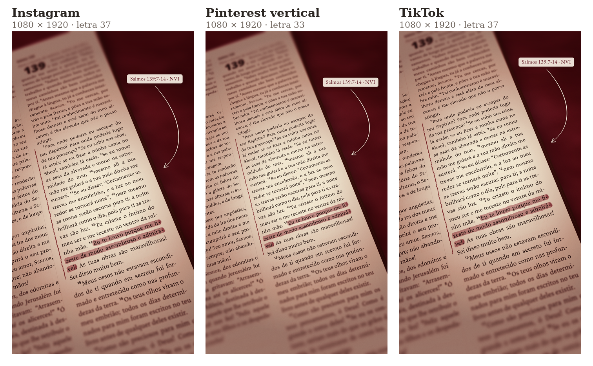
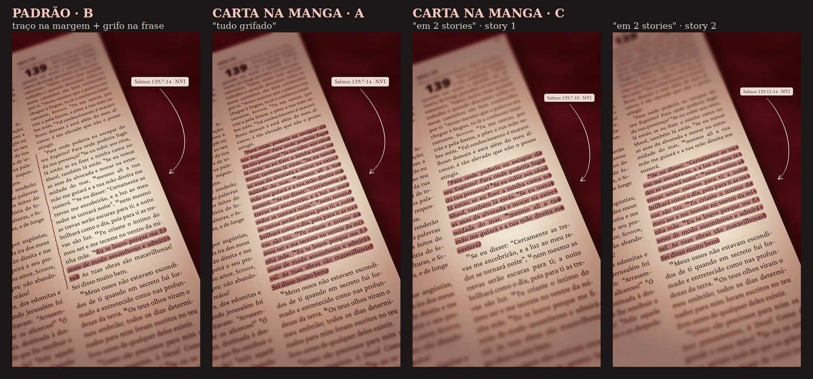
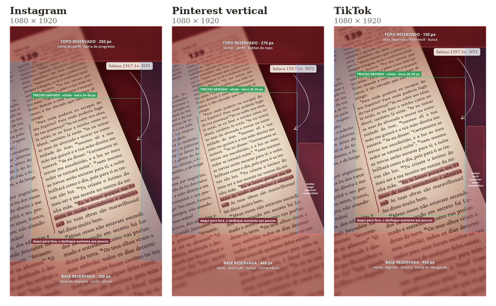
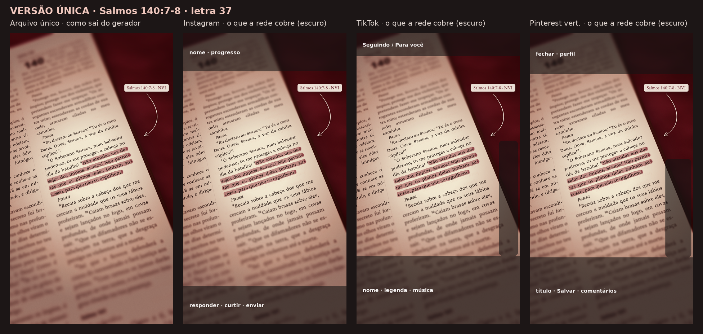

# Guia do modelo: trechos da Bíblia para o Stories (versão oficial)

## A arte

Uma foto "espontânea" de uma Bíblia aberta: a página em close e na diagonal, com o trecho nítido e grifado, o resto da página desfocando aos poucos, luz baixa com as bordas caindo para vinho escuro e, ao lado da Bíblia, sobre o veludo, uma caixinha com a referência e uma seta feita à mão apontando para o trecho.

| Elemento | Como é |
|---|---|
| Página | Papel bíblia creme, duas colunas, cabeçalho e número da página, números dos versículos, títulos de seção, número grande do capítulo, "Senhor" em versalete e o verso da folha aparecendo de leve. A abertura do capítulo fica **desfocada** junto com o resto da página, sem destaque |
| Trecho | Na coluna da direita, todo nítido |
| Grifo | Marca-texto **vinho** na frase pedida (borda irregular, levemente torto) |
| Traço na margem | Em trecho longo: risco de caneta vinho na margem, do começo ao fim do trecho |
| Desfoque | Faixa nítida em volta do trecho; o desfoque aumenta **aos poucos, em 9 níveis**, para cima e para baixo (degradê suave, sem "faixas") |
| Luz e cor | Luz baixa e quente no trecho, bordas em vinho escuro, granulado de filme |
| Em volta | Veludo vinho, capa de couro e corte das folhas avermelhado |
| **Caixinha** | Creme, comprida e fina, **uma linha só**: "Salmos 139:7-14 · NVI". Fica **sobre o veludo, ao lado da Bíblia**, nunca em cima da página nem do trecho. Letra 32 (diminui até 28 se o veludo for estreito) |
| **Seta** | Traço fino como feito com o dedo (afina nas pontas), ponta aberta. Sai do **centro** da caixinha, faz um arco suave pelo veludo e chega **apontando para o trecho como um todo**; a ponta para no veludo, com folga da borda da Bíblia |

## Padrão (quando você não diz nada)

| Item | Padrão |
|---|---|
| Formato | PNG 1080 × 1920 nas 3 redes |
| Versão | **NVI**, sempre (inclusive os versículos vizinhos que completam a página) |
| Trecho curto (até 3 versículos e até 300 letras) | Trecho nítido + grifo na frase pedida (sem frase = trecho todo grifado) |
| Trecho longo (4 versículos ou mais, ou mais de 300 letras) | **Jeito B:** trecho nítido + traço na margem + grifo na frase-chave |
| Citação | Caixinha no veludo + seta fluida |
| Tamanho da letra | Automático: começa em 50 px e diminui até o trecho caber na área livre **e** a caixinha caber no veludo (mínimo por rede: veja abaixo) |
| Texto | Transcrito fielmente, sem mudar as palavras |
| Contexto da página | Eu completo com os versículos vizinhos (antes, depois e a coluna ao lado), que ficam desfocados |
| Textos por cima da foto | Só a caixinha e a seta. Nada de legenda, assinatura ou @ |

## Letra mínima e divisão por rede

| Rede | Letra mínima | Se o trecho não couber |
|---|---|---|
| **Instagram** | 24 px | Divido em **2 stories** automaticamente, cortando no fim de um versículo perto da metade; cada story mostra na caixinha só os versículos dele (ex.: "Salmos 139:7-10" e "Salmos 139:11-14") |
| **TikTok** | 20 px | Sempre **1 imagem** |
| **Pinterest vertical** | 20 px | Sempre **1 pin** |

No TikTok e no Pinterest, se o trecho não couber nem com letra 20, a letra continua diminuindo até 16 e eu aviso. Nesse caso, o ideal é encurtar o trecho.

Nos exemplos: Salmos 139:7-14 (8 versículos) ficou com letra 37 (Instagram e TikTok) e 33 (Pinterest vertical); Salmos 23:4 com 48 / 42 / 45; 1 Coríntios 13:4-7 com 39 / 34 / 36.

## Trechos longos: o padrão e as cartas na manga

| | Jeito | Como fica | Como pedir |
|---|---|---|---|
| **Padrão** | **B · Traço na margem + grifo na frase-chave** | Trecho todo nítido, traço vinho na margem, marca-texto só na frase-chave | É o padrão: basta mandar o trecho e dizer a frase. Se você não disser, eu escolho a frase mais marcante e te aviso |
| Carta na manga | **A · Tudo grifado** | Marca-texto em todas as linhas do trecho | "tudo grifado" |
| Carta na manga | **C · Em 2 stories** | Instagram em 2 stories, cada um com metade do trecho grifado, letra maior e a própria referência na caixinha. TikTok e Pinterest continuam em 1 imagem | "em 2 stories" (ou "divide em 2") |

As cartas na manga combinam: "em 2 stories com traço" faz cada story no jeito B.

## Áreas livres (iguais ao modelo de livros)

| Área | Instagram | TikTok | Pinterest vertical |
|---|---|---|---|
| Tamanho | 1080 × 1920 | 1080 × 1920 | 1080 × 1920 |
| Topo livre | 250 px | 150 px | 270 px |
| Base livre | 250 px | 450 px | 440 px |
| Laterais livres | 150 px | 150 px | 195 px |

O trecho fica sempre **inteiro dentro da área livre**. A caixinha também fica entre o topo e a base livres, mas pode avançar pelas laterais (no TikTok e no Pinterest ela costuma ficar acima da coluna de botões; se um dia cair sob eles, tudo bem). A página da Bíblia pode passar por baixo das áreas reservadas, porque ali ela já está desfocada.

## Versão única para as 3 redes (`"plataforma": "universal"`)

Como as 3 redes usam 1080 × 1920, uma imagem só serve para todas se o trecho, a caixinha e a seta ficarem na área livre **comum**: topo 270 px (Pinterest), base 450 px (TikTok), laterais 195 px (Pinterest), e a caixinha e a ponta da seta longe da coluna de botões do TikTok e do Pinterest.

| Trecho | Versão única | Instagram / Pinterest / TikTok separados |
|---|---|---|
| Salmos 140:7-8 | letra 37 | 43 / 37 / 40 |
| Salmos 23:4 | letra 42 | 48 / 42 / 45 |
| Salmos 139:7-14 | letra 33 | 37 / 33 / 37 |
| 1 Coríntios 13:4-7 | letra 33 | 39 / 34 / 36 |

A letra fica igual à do Pinterest vertical (a rede mais restrita), um pouco menor que no Instagram. A letra mínima é 24: se o trecho não couber, o script avisa para gerar as 3 versões (o Instagram vira 2 stories). Exemplo com 8 versículos: [referencia/versao-unica-salmos-139.png](referencia/versao-unica-salmos-139.png).

## Opções (é só pedir)

| Você diz | Resultado |
|---|---|
| "[referência], grifa [frase]" | Grifo vinho só na frase pedida |
| "grifa [frase 1] e [frase 2]" | Dois (ou mais) grifos separados no mesmo trecho |
| "tudo grifado" | Carta na manga A |
| "em 2 stories" / "divide em 2" | Carta na manga C (só Instagram) |
| "sem traço" / "com traço" | Tira ou põe o traço na margem |
| "sem caixinha" | Só a foto, sem a referência |
| "grifo cereja / castanho / vermelho" | Grifo nessa cor |
| "em couro" / "em madeira" | Troca o veludo pela superfície pedida |
| "só até [palavra]" / "começa em [palavra]" | Corto o trecho onde você indicar |

**Exemplo de pedido:**

> [print] Salmos 139:7-14, grifa "Eu te louvo porque me fizeste de modo assombroso e admirável"

Resultado: [referencia/exemplo-salmos-139-7-14.png](referencia/exemplo-salmos-139-7-14.png)

Outros exemplos: [Salmos 23:4](referencia/exemplo-salmos-23-4.png) (trecho curto) e [1 Coríntios 13:4-7](referencia/exemplo-1-corintios-13-4-7.png) (dois grifos).

## Paleta

| Cor | Grifo (sobre o papel, em multiplicação) |
|---|---|
| Vinho (padrão) | `rgba(140,20,45,.44)` |
| Cereja | `rgba(210,36,70,.40)` |
| Castanho avermelhado | `rgba(168,70,40,.42)` |
| Vermelho | `rgba(225,45,45,.38)` |

| Elemento | Cor |
|---|---|
| Papel | `#F2EADC` |
| Tinta | `#251D19` |
| Veludo | `#4E0E18` |
| Capa de couro | `#4A1A16` |
| Corte das folhas | `#8E2A26` |
| Caixinha | fundo `rgba(243,234,223,.95)`, letra `#5E1621` (EB Garamond) |
| Seta | `#F6EBDD` |
| Traço na margem | `rgba(122,20,38,.85)` |

## Histórico da criação

Pasta [`referencia/historico/`](referencia/historico/):

- `rascunhos-v1.png`: primeiros caminhos (página grifada × frase sobre a Bíblia).
- `rascunhos-v2-grifado.png`: cores da marca. Escolhido o **vinho**, sem fita marcadora e sem assinatura.
- `citacao-3-opcoes.png`: como citar o versículo (cabeçalho em destaque, caixinha, letra à mão).
- `citacao-caixinha-no-veludo.png`: caixinha ao lado da Bíblia, sobre o veludo. Escolhida a **caixinha** (não a letra à mão), sem cabeçalho em destaque.
- `citacao-seta-variacoes.png`: de onde sai a seta. Escolhida a **seta fluida saindo do centro**, apontando para o trecho todo.
