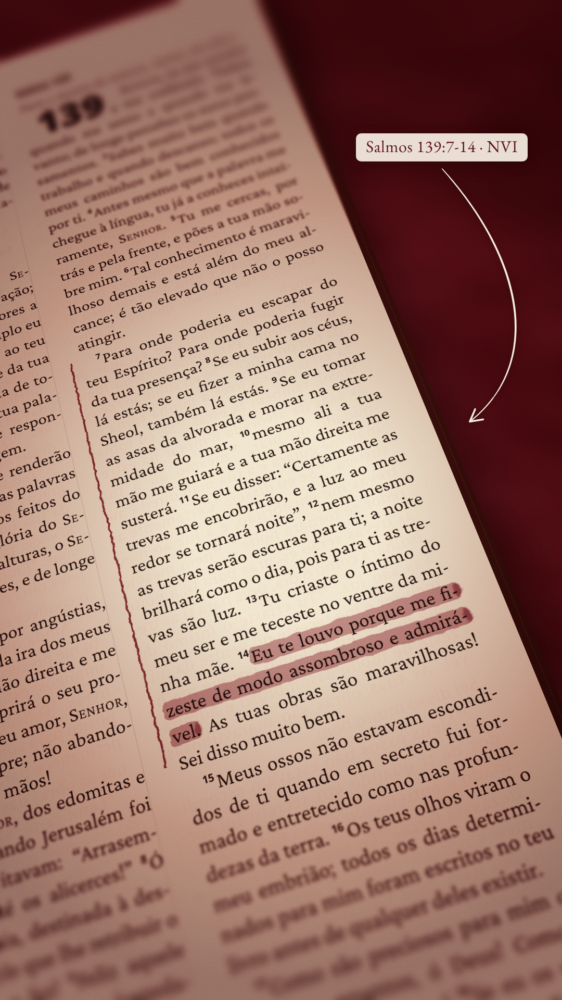

# Stories de trechos da Bíblia

Modelo **oficial** para transformar trechos da Bíblia (NVI) em stories do **Instagram**, do **TikTok** e em pins do **Pinterest vertical**, com cara de foto espontânea: a Bíblia aberta em close, com o trecho grifado, foco raso e luz baixa em tons de vinho, e uma caixinha com a referência sobre o veludo, com seta apontando para o trecho.

- **Regras, mapa e opções:** veja [GUIA.md](GUIA.md)
- **Exemplos:** pasta [`referencia/`](referencia/)



Usa as **mesmas regras do modelo de trechos de livros** (`stories-livros`): mesmas áreas livres por rede, letra automática de 50 até o mínimo da rede e as mesmas regras de divisão. Só a arte é diferente.

## Estrutura

| Arquivo / pasta | Para que serve |
|---|---|
| `modelo-grifado.html` | A arte: página da Bíblia, grifo, foco, cores e luz |
| `gerar.js` | Gera o PNG a partir de um pedido em JSON |
| `pedidos/` | Pedidos em JSON (um por imagem); `pedidos/variacoes/` tem exemplos das cartas na manga |
| `referencia/` | Mapa das zonas e exemplos oficiais; `referencia/historico/` tem as etapas da criação |
| `saida/` | Imagens geradas (não vão para o Git) |
| `modelo-fundo.html` | Rascunho de outro estilo (Bíblia de fundo + frase por cima), para depois |

## Como gerar

Precisa de Node.js com Playwright e acesso à internet (para as fontes do Google Fonts).

```bash
node gerar.js pedidos/2026-11-18-salmos-139-7-14-1-instagram.json
```

Exemplo de pedido (o post oficial: trecho longo, jeito B, caixinha no veludo):

```json
{
  "texto": "<p><sup>7</sup>Para onde poderia eu escapar do teu Espírito? … <sup>14</sup>Eu te louvo porque me fizeste de modo assombroso e admirável. As tuas obras são maravilhosas! Sei disso muito bem.</p>",
  "grifo": "Eu te louvo porque me fizeste de modo assombroso e admirável.",
  "antes": "<p>…versículos anteriores…</p>",
  "depois": "<p>…versículos seguintes…</p>",
  "outraColuna": "<p>…texto da coluna ao lado…</p>",
  "cabecalho": "Salmos 138, 139",
  "pagina": "897",
  "referencia": "Salmos 139:7-14",
  "versao": "NVI",
  "plataforma": "instagram",
  "saida": "saida/2026-11-18-salmos-139-7-14-1-instagram.png"
}
```

- `texto`: o trecho, na NVI, sem marcação. Parágrafos em `<p>`, número do versículo em `<sup>`. "SENHOR" e "DEUS" em maiúsculas viram versalete, como nas Bíblias.
- `grifo`: a frase (ou lista de frases) que recebe marca-texto. Precisa estar escrita igual ao texto.
- `jeito`: em branco, o script decide pelo tamanho do trecho: até 3 versículos e 300 letras é `grifo` (trecho nítido + grifo); a partir de 4 versículos ou 300 letras é `traco` (jeito B, com traço na margem). Carta na manga A: `"jeito": "tudo"`.
- `dividir`: carta na manga C, `true` gera 2 stories no Instagram (`…-parte1.png` e `…-parte2.png`). No Instagram a divisão também acontece sozinha quando a letra precisaria ficar abaixo de 24 (desligue com `false`).
- `traco`: `false` tira o traço na margem; `true` põe.
- `referencia` e `versao`: aparecem na **caixinha** sobre o veludo, com seta fluida apontando para o trecho (padrão). `versao` é `NVI` se ficar em branco. `"etiqueta": false` tira a caixinha.
- `antes`, `depois` e `outraColuna`: os versículos vizinhos que completam a página. Ficam desfocados, só para a página parecer real. Preencha sempre o `depois`.
- `cabecalho` e `pagina`: o cabeçalho da página da Bíblia.
- Avançado: o `texto` também pode vir com `<span class="mt">` (grifo) e `<span class="foco">` (nítido, sem grifo) prontos; aí `grifo` e `jeito` são ignorados.

Campos opcionais: `plataforma` (`instagram` padrão, `tiktok`, `pinterest-vertical`), `cor` do grifo (`vinho` padrão, `cereja`, `castanho`, `vermelho`), `superficie` (`veludo` padrão, `couro`, `madeira`), `tom` (`vinho` padrão, `quente`, `pb`), `minFonte` e `mapa` (`true` desenha o mapa de zonas). Ajustes finos: `giro`, `inclinacao`, `lado`, `focoX`, `focoY`, `desfoque`, `escuro`; da caixinha e da seta: `letraCaixinha` (máx. 32), `etiquetaAcima`, `setaAltura`, `setaFolga`, `setaS`, `setaAbre`, `setaChega`, `setaSaida`. Formas testadas e guardadas (fora do padrão): `"citacao": "cabecalho"` (livro e capítulo em destaque na página) e `"etiqueta": "mao"` (referência em letra à mão).

O script informa o tamanho de letra usado e se o trecho coube (`{ fonte: 37, cabe: true }`). No Instagram, se não couber com letra 24, ele mesmo divide em 2 stories. No TikTok e no Pinterest a imagem é sempre única: o script avisa (`aviso`) quando a letra fica abaixo de 20 ou o trecho não cabe, e aí o ideal é encurtar.

Os pedidos seguem o mesmo padrão de nome do modelo de livros: `AAAA-MM-DD-<trecho>-1-instagram.json`, `-2-pinterest-vertical.json` e `-3-tiktok.json`.
