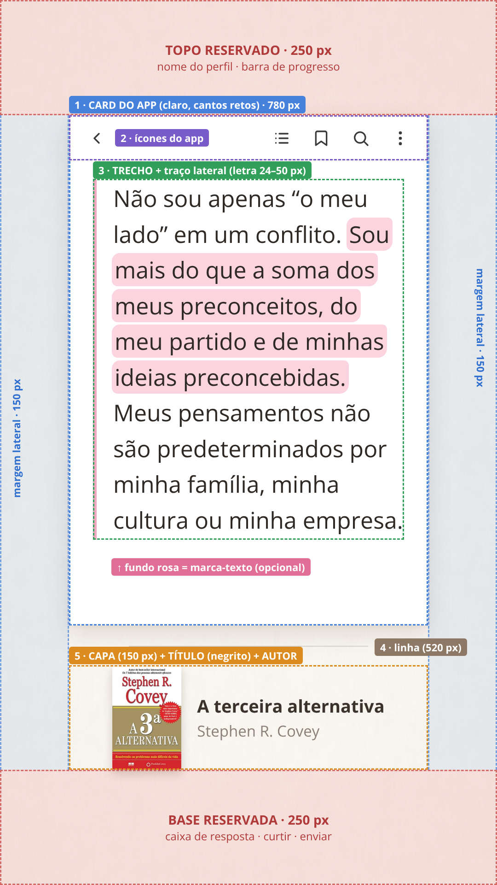
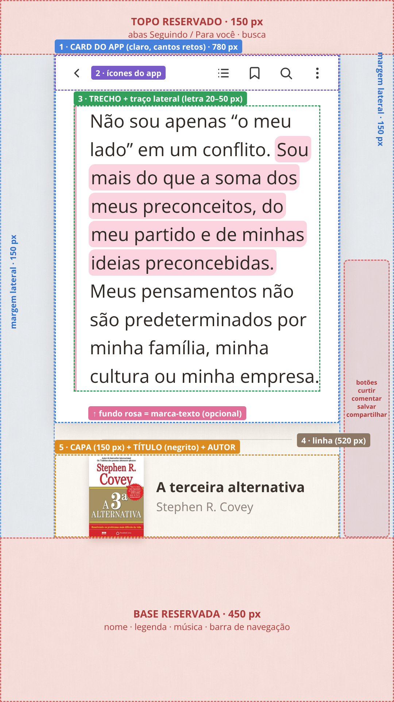
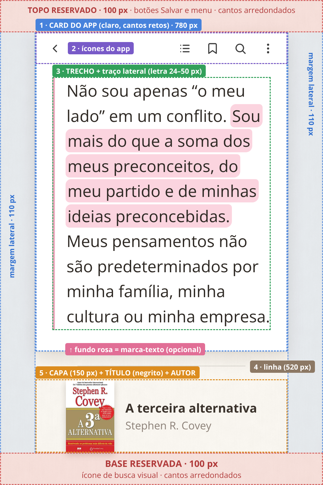

# Guia do modelo: trechos de livros para o Stories

## Mapa do story (1080 × 1920 px)

| Área | O que é | Medida |
|---|---|---|
| Topo | Livre (nome do perfil e barra de progresso do Instagram) | 250 px |
| Laterais | Livres | **150 px** de cada lado |
| **1 · Card do app** | "Print" de app de leitura: claro, cantos retos, sombra leve | 780 px de largura, do topo livre até a linha |
| **2 · Ícones** | Voltar, índice, marcador, busca e menu | Barra no alto do card |
| **3 · Trecho** | Texto com traço lateral, começando logo abaixo dos ícones | Letra automática de 50 a 24 px |
| **4 · Linha** | Separador fino entre o card e o livro | 520 px, centralizada |
| **5 · Livro** | Capa + **título em negrito** + autor em cinza, centralizados | Capa com 150 px de largura |
| Base | Livre (caixa de resposta, curtir e enviar) | 250 px |

## Padrão (quando você não diz nada)

| Item | Padrão |
|---|---|
| Formato | PNG 1080 × 1920 |
| Fundo | Off-white quase branco, com textura de papel bem leve |
| Card | Sempre claro, mesmo que o print enviado seja de app escuro |
| Fonte | Open Sans, em cor café escuro |
| Tamanho da letra | Automático: 50 px em trecho curto, diminuindo até caber (mínimo 24 px) |
| Traço lateral | Rosa pastel |
| Marca-texto | Nenhum, só quando você pedir |
| Negrito | Nenhum, só quando você pedir |
| Capa | Recortada do print ou buscada na internet em boa resolução |
| Texto | Transcrito fielmente: tiro hifenização e quebras de linha da página, sem mudar as palavras |
| Divisão | Sempre 1 story. Só vira 2 se a letra precisar ficar menor que 24 px, cortando no fim de um parágrafo ou de uma frase |

## Opções (é só pedir)

| Você diz | Resultado |
|---|---|
| "destaca [frase]" | Marca-texto rosa pastel na frase |
| "destaca [frase] em azul / verde / lilás / amarelo" | Marca-texto nessa cor; o traço lateral acompanha a cor |
| "traço preto" | Traço lateral preto; o destaque continua na cor pedida |
| "negrito em [frase]" | Negrito na frase; dá para combinar com marca-texto |
| "livro: [título] – [autor]" | Uso esses dados quando eles não aparecem no print |
| "capa: [foto]" | Uso a capa enviada |
| "divide em 2" | Força 2 stories, mesmo se coubesse em 1 |
| "só até [palavra]" / "começa em [palavra]" | Corto o trecho onde você indicar |

**Exemplo de pedido:**

> [print] destaca "Sou mais do que a soma dos meus preconceitos" em azul e negrito em "minha cultura"

Resultado: [referencia/exemplo-azul-negrito.png](referencia/exemplo-azul-negrito.png)

## Paleta

| Cor | Marca-texto | Traço |
|---|---|---|
| Rosa pastel (padrão) | `rgba(247,176,196,.55)` | `#EFA9BF` |
| Azul pastel | `rgba(160,200,240,.55)` | `#9EC3EA` |
| Verde pastel | `rgba(178,226,190,.55)` | `#A3D6B0` |
| Lilás pastel | `rgba(205,185,240,.55)` | `#BFA9E8` |
| Amarelo pastel | `rgba(250,226,140,.6)` | `#EFD27A` |
| Traço preto (opcional) | n/a | `#2B2622` |

---

# Versão TikTok

Mesmo modelo e mesmas opções. Só mudam as áreas livres, porque a interface do TikTok cobre partes diferentes da tela.

| Área | Instagram | TikTok |
|---|---|---|
| Topo livre | 250 px | **150 px** (abas Seguindo / Para você e busca) |
| Base livre | 250 px | **450 px** (nome, legenda, música e barra de navegação) |
| Laterais livres | 150 px | 150 px (já cobre a coluna de botões à direita, de ~140 px) |
| Card do app | 780 px de largura | 780 px de largura, um pouco mais baixo |
| Livro (item 5) | igual | igual |

- O conteúdo fica mais para cima e sobra mais fundo embaixo, onde entram a legenda e a música do TikTok.
- O card tem cerca de 100 px a menos de altura, então trechos longos ficam com a letra 1 ou 2 pontos menor (o trecho de exemplo ficou com 25 px, contra 26 no Instagram).
- **Como pedir:** diga "versão TikTok" ou "faz pro Instagram e pro TikTok".

---

# Versão Pinterest

Mesmo visual e mesmas opções, mas em **formato de pin: 1000 × 1500 px (proporção 2:3)**, o tamanho recomendado pelo Pinterest. Imagens 9:16 aparecem cortadas no feed.

| Área | Instagram | TikTok | Pinterest |
|---|---|---|---|
| Tamanho | 1080 × 1920 | 1080 × 1920 | **1000 × 1500** |
| Topo livre | 250 px | 150 px | **100 px** (botões Salvar e menu ao abrir o pin; cantos arredondados) |
| Base livre | 250 px | 450 px | **100 px** (ícone de busca visual; cantos arredondados) |
| Laterais livres | 150 px | 150 px | **110 px** (o Pinterest não cobre as laterais) |
| Card do app | 780 px | 780 px | 780 px |
| Livro (item 5) | igual | igual | igual |

- O pin é mais baixo, então usei laterais um pouco menores. Assim o card mantém a mesma largura (780 px) e o trecho longo de exemplo cabe com letra de 25 px.
- O fundo, o card, os ícones, o traço, o marca-texto e o bloco do livro são os mesmos.
- **Como pedir:** diga "versão Pinterest" ou "faz pras três redes".
