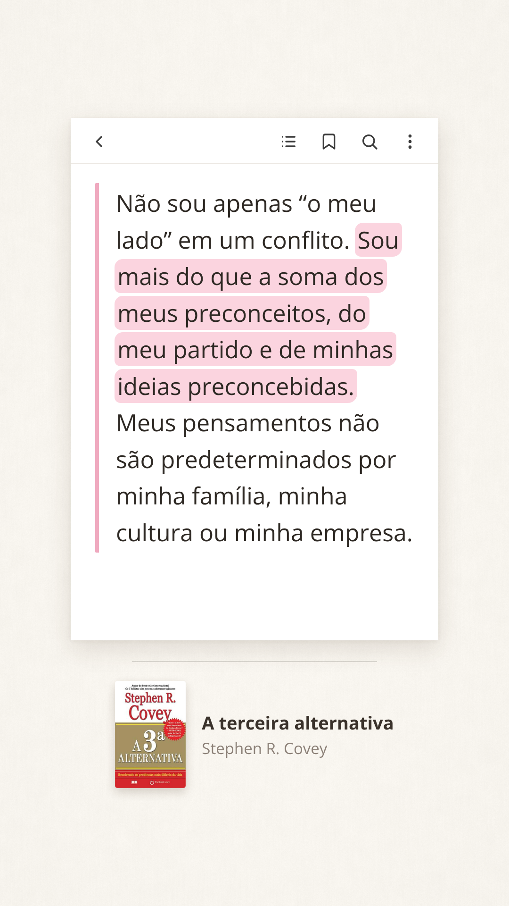
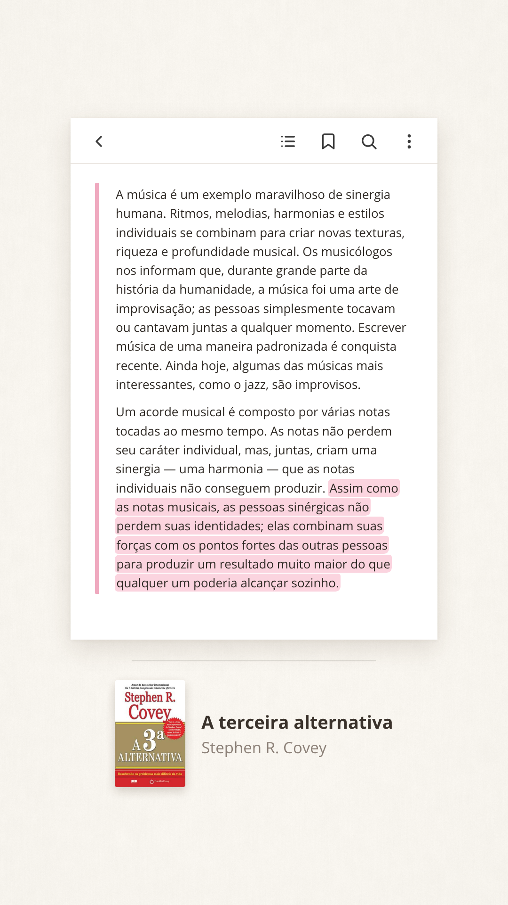
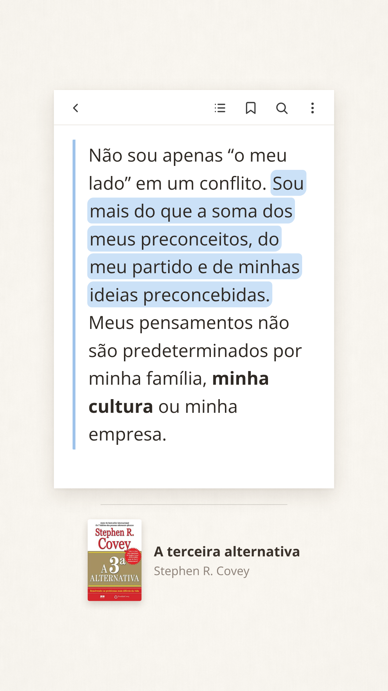

# Stories de trechos de livros

Modelo para transformar trechos de livros (prints, fotos ou texto) em stories do Instagram e do TikTok e em pins do Pinterest, no estilo "print de app de leitura" sobre um fundo de papel off-white.

- **Regras, mapa e opções:** veja [GUIA.md](GUIA.md)
- **Exemplos:** pasta [`referencia/`](referencia/) (Instagram, TikTok e Pinterest)

| Curto | Longo | Destaque azul + negrito |
|---|---|---|
|  |  |  |

## Estrutura

| Arquivo / pasta | Para que serve |
|---|---|
| `modelo.html` | O layout do story (medidas, cores, fontes) |
| `gerar.js` | Gera o PNG a partir de um pedido em JSON |
| `fundo.png` | Textura de papel do fundo |
| `capas/` | Capas dos livros já usados |
| `pedidos/` | Pedidos em JSON (um por story) |
| `referencia/` | Mapa do esqueleto e exemplos |
| `saida/` | Stories gerados (não vão para o Git) |

## Como gerar um story

Precisa de Node.js com Playwright e acesso à internet (para a fonte Open Sans do Google Fonts).

```bash
node gerar.js pedidos/exemplo-curto.json
```

Exemplo de pedido (`pedidos/meu-story.json`):

```json
{
  "texto": "<p>Primeiro parágrafo com <span class=\"mt\">frase destacada</span> e <b>negrito</b>.</p><p>Segundo parágrafo.</p>",
  "cor": "rosa",
  "capa": "capas/a-terceira-alternativa.jpg",
  "titulo": "A terceira alternativa",
  "autor": "Stephen R. Covey",
  "saida": "saida/meu-story.png"
}
```

Campos opcionais: `plataforma` (`instagram` padrão, `tiktok`, `pinterest` (feed, 1000×1500) ou `pinterest-vertical` (1080×1920)), `cor` (`rosa`, `azul`, `verde`, `lilas`, `amarelo`), `traco` (`preto`), `lateral` (margem em px, padrão 150), `minFonte` (letra mínima; padrão 24 no Instagram e 20 no TikTok e no Pinterest) e `mapa` (`true` desenha o mapa de zonas).

O script informa o tamanho de letra usado e se o texto coube (`{ fonte: 50, cabe: true }`). No Instagram, se `cabe` for `false`, divida o trecho em dois pedidos. No TikTok e no Pinterest a imagem é sempre única: o script avisa (`aviso`) quando a letra fica abaixo de 20 ou o texto não cabe, e aí o ideal é encurtar o trecho.
